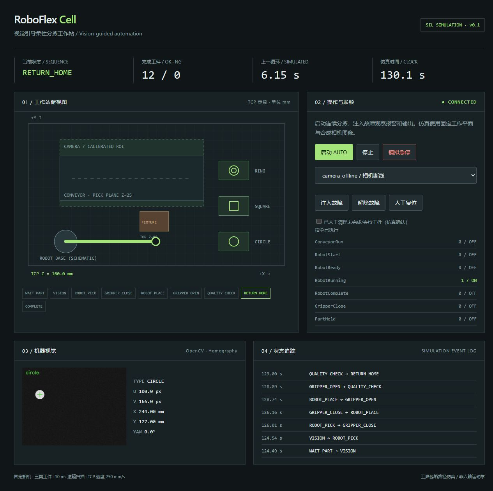
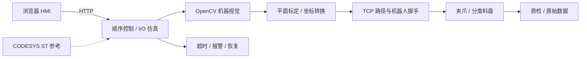

# RoboFlex Cell

**基于机器视觉的机器人柔性分拣工作站 · Software-in-the-loop automation cell**

[中文详细说明](README_CN.md) · [系统架构](docs/system_architecture.md) · [测试报告](docs/test_report.md) · [机械方案](docs/mechanical_design.md) · [电气方案](docs/electrical_design.md)

面向非标自动化与机器人集成的工程作品：把停带来料、视觉识别、坐标转换、机器人任务握手、夹持、分类放置、异常恢复和测试记录串成一个可复现的闭环。项目可以在 Windows/Linux 上直接运行，无需机器人硬件。

> **当前版本 v0.1：Python/OpenCV 软件在环仿真。** CODESYS ST 为未编译参考代码，SVG/DXF 为概念图。没有运行 KUKA 真机、ROS2/MoveIt 或实际 PLC；本版本完成分拣，没有实体装配。





## 5 分钟运行

需要 Python 3.10–3.12。PowerShell：

```powershell
# 用最终仓库链接克隆，或下载 ZIP 解压后进入项目目录
cd RoboFlex-Cell
python -m venv .venv
.\.venv\Scripts\python.exe -m pip install -e ".[test]"
.\.venv\Scripts\python.exe -m roboflex.cli serve
```

打开 **http://127.0.0.1:8080**，点击“启动 AUTO”。Linux/macOS 使用 `.venv/bin/python`。先配置合适的 Python 解释器，Windows 应用商店占位别名不能代替实际安装。

```powershell
# 运行测试
.\.venv\Scripts\python.exe -m pytest -q
# 生成 100 次仿真记录，包含 JSON 原始数据与 CSV
.\.venv\Scripts\python.exe -m roboflex.cli benchmark --cycles 100 --seed 42
# 重新生成故障证据、标定实验、概念图
.\.venv\Scripts\python.exe scripts/fault_report.py
.\.venv\Scripts\python.exe scripts/calibration_report.py
.\.venv\Scripts\python.exe scripts/generate_drawings.py
```

## 已完成内容

- **视觉**：噪声合成图、圆形/方形/环形轮廓识别、平面单应标定、基坐标方向变换、标定区域越界与目标不唯一拒绝。
- **自动控制**：10 ms 逻辑扫描、任务握手、6 s 运动超时、生产计数、12 种故障注入与锁存恢复。
- **运动**：高位预抓/预放，250 mm/s TCP 位置积分，工具包络与夹具的连续线段碰撞检查。
- **工程资料**：六个 ST 功能块、机械布局和两件零件草图、DXF、BOM、电气方案、25 条 I/O、验收矩阵、原始测试数据。
- **HMI**：实时工作站示意、合成相机图像、定位坐标、I/O、状态日志与人工复位。

43 项本地自动化测试通过；seed=42 的 100 次正常仿真均完成，平均**仿真**周期 6.3255 s，P95 6.721 s。理想平面合成图定位最大误差 0.0499 mm；这不是实体相机或机器人精度。更接近实际标定不确定性的独立噪声实验见[测试报告](docs/test_report.md)。GitHub CI 对 Windows/Linux 和 Python 3.10/3.12 运行相同测试并上传每次基准结果。

## 目录

```text
src/roboflex/          视觉、标定、运动、控制器、HTTP HMI
plc/codesys/          ST 功能块与导入说明（未编译）
cad/                 BOM、SVG/DXF 概念图
electrical/          控制方案与 I/O 表
tests/               视觉、运动、流程、故障恢复与 HTTP 测试
scripts/             基准证据、图纸生成与 Windows 启动
docs/evidence/       100 次循环原始数据、12 种故障、标定实验
docs/                需求、设计、报告、面试演示与简历表述
media/               实际 HMI 截图
.github/workflows/   Windows / Linux 自动化验证
```

## 工程边界

TCP 仿真没有六轴运动学、连杆碰撞、加速度或实际负载，不能代替 MoveIt/厂家控制器验证。工件高度固定，单应标定不等同于相机内参或 3D 手眼标定。安全输入只用于软件联锁验证，实体安全回路需要独立设计。下一阶段的 KUKA/ROS2 集成步骤见[机器人集成文档](docs/robot_integration.md)。

## English

RoboFlex Cell is a reproducible **software-in-the-loop** vision-guided sorting workstation. Python/OpenCV implements contour detection, planar pixel-to-base calibration, a cyclic sequence, latched robot handshakes, tool-envelope clearance checks, fault injection and a local browser HMI. Original concept SVG/DXF drawings, a BOM, an I/O list and uncompiled CODESYS ST references accompany the executable simulation.

The current release does **not** claim physical KUKA commissioning, ROS2/MoveIt execution, six-axis dynamics, compiled PLC software or manufactured CAD. Benchmark results describe synthetic images and simulated time; raw records and reproduction commands are provided. MIT licensed.
