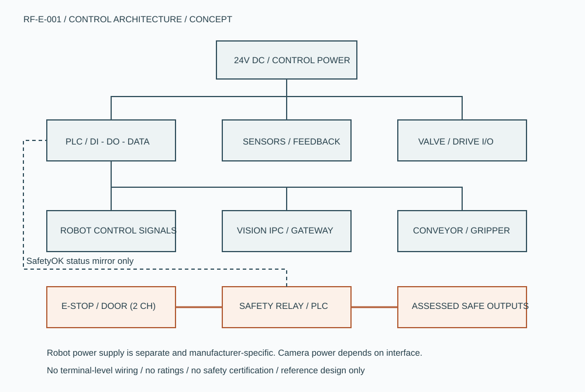

# 电气方案与 I/O

24V DC 为控制侧概念供电；工业机器人驱动的功率供电需按厂家规格单独设计。图中没有额定电流、导线截面积、保护协调或端子施工细节，属于方案图，不是 EPLAN 工程或接线施工图。

I/O 表见 [`electrical/io/io_list.csv`](../electrical/io/io_list.csv)，地址为工程建议，尚未绑定具体 PLC 设备。当前 Python 仿真没有实体 `%IX/%QX` 映射；ST 的输入/输出由工程实例映射。

PNP 传感器候选：棕线 +24V、蓝线0V、黑线输出接PLC输入；实际设备必须核对数据手册和输入模块共地/极性。电磁阀驱动根据模块容量选择中间继电器或驱动器，感性负载需要适当的抑制措施。相机使用自身接口供电或 PoE，不假设所有相机可直接接24V。

急停/安全门进入独立安全回路，普通 PLC 读取 SafetyOK 镜像用于状态显示和程序联锁。Python 中一扫描停止的测试不代表安全停止时间；ST 里的 RobotStop 只是普通停止请求。机械风险、夹持保持、气动残能以及重新启动必须在实体设计阶段评估。

通信建议：视觉工控机通过经验证的网关发布工件类别/坐标/事务编号；机器人通过自身许可接口接受任务；PLC监督 Ready/Running/Complete/Error。当前真实通信仅有本地 HMI HTTP，未实现 OPC UA、KUKA EKI/RSI、现场总线或独立 TCP 设备端。
