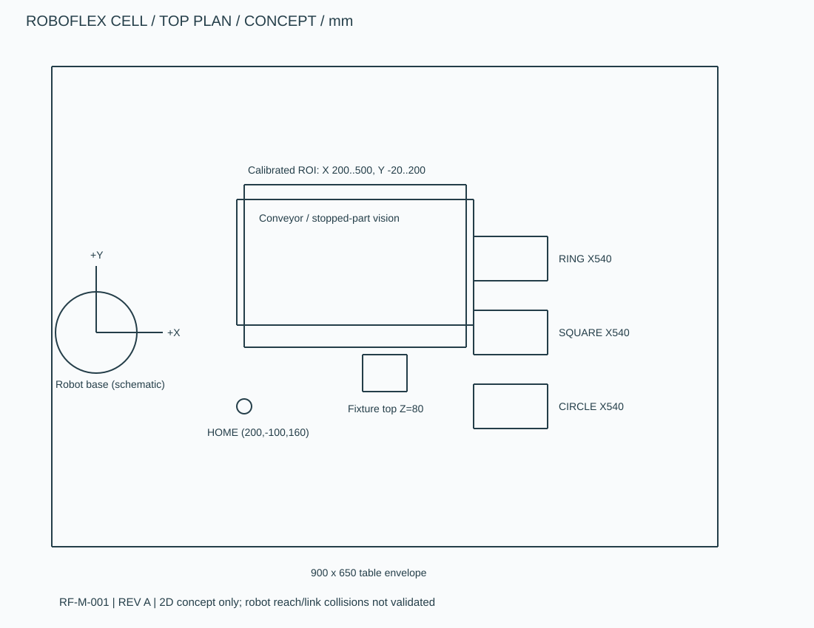

# 机械概念方案

交付是带尺寸的 **SVG + DXF 概念草图**，可用于讨论布局或在 AutoCAD 中继续设计，不是 SolidWorks 装配体、制造图或已经加工的零件。生成源为 `scripts/generate_drawings.py`，`python scripts/generate_drawings.py` 可重建。

| 图号 | 图纸 | 内容 |
|---|---|---|
| RF-M-001 | cell_layout.svg / .dxf | 900×650 工作台包络；停带、相机 ROI、料盘、夹具、Home 布局 |
| RF-M-002 | camera_plate.svg / .dxf | 120×100×8 相机安装板；4×Ø9，孔距 80×60 |
| RF-M-003 | sample_tray.svg / .dxf | 200×120×15 示例料盘；圆/环 Ø36、方孔34，深6 |

DXF 为 ASCII R12 LINE/CIRCLE/TEXT，所有数值按 mm 解释。图纸中基坐标 X/Y 与代码一致；机器人底座图标只示意安装位置，不代表厂家法兰尺寸。SVG viewBox 单位用于表示相同的几何数字；打印或导入需确认比例。不能直接下单制造。

结构校核：`python -m pip install -e ".[cad]"`，然后 `python scripts/check_deliverables.py`；检查SVG XML、Markdown本地链接以及ezdxf读取/audit结果。它验证文件格式，不验证机械受力或制造工艺。

三类工件合成尺寸：圆/环外径 28，环内径13，方形25，厚度假设5；SIL 的抓取平面统一 Z=25。相机固定在工作区上方，建议镜头垂直工作平面；视野至少覆盖300×220并留余量。模型假设已去畸变，不代表选定镜头的实际精度。

夹具占 X360..420、Y-80..-30，顶面80。工具包络半径20，上方运行高度160。该高度只证明 TCP 包络模型中存在净空，不证明六轴机器人所有连杆无碰撞。

选型考虑：机器人按工作范围、负载和安装形式评估；夹爪按最重工件、摩擦系数、加速度和失压保持评估；相机按视野/最小特征/定位精度/曝光评估；型材工作台按振动和刚度评估。候选项见 BOM，未提供供应商确认、承载计算、价格或采购结果。当前未建模安全围栏尺寸、线缆拖链、抓手法兰和可维护空间。

后续实作优先：准确机器人数据 → 完整机器人工作空间/连杆碰撞 → 夹爪选型与底座 → 相机适配孔 → 可调支架 → 公差/基准/气路 → 装配与重复定位测量。保留图号与修订记录，完成后再转换成生产图。
