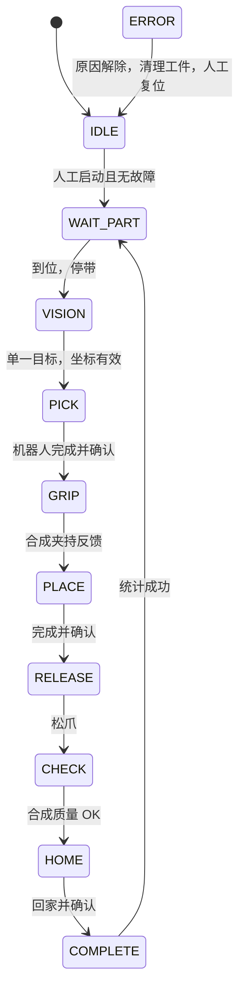

# 自动流程、报警与恢复

任一活动状态发生故障进入 ERROR，第一条报警保持。输送线和 RobotStart 关闭，Robot.stop 保留当前位置；已抓工件保留夹持。`clear_fault` 只移除注入原因，不清除报警。复位要求原因已消失；持件时还需 `clear_part=true` 表示在仿真中人工清理。复位回 IDLE，必须再次 Start。已实现的 Stop 是锁存停止并要求清理/复位，不是可继续的暂停。

| 故障注入值 | 报警 | 触发阶段 | 检测/超时 |
|---|---|---|---|
| camera_offline | ALM-001 | VISION | 捕获时断线 |
| vision_fail | ALM-002 | VISION | 识别失败/目标不唯一 |
| robot_not_ready | ALM-003 | 运动前 | 未就绪拒绝 |
| robot_timeout | ALM-004 | PICK/PLACE/HOME | 运动冻结，6 s 超时 |
| gripper_fail | ALM-005 | GRIP | 0.5 s 无闭合反馈 |
| part_dropped | ALM-006 | CHECK | 合成放置失败，计 NG |
| communication_loss | ALM-007 | 活动状态 | 0.5 s 心跳陈旧 |
| sensor_stuck | ALM-008 | WAIT_PART | 2 s 无到位 |
| conveyor_jam | ALM-009 | WAIT_PART | 2 s 无进料 |
| estop | ALM-010 | 任意状态 | 下一扫描进入 ERROR |
| door_open | ALM-011 | 任意状态 | 下一扫描进入 ERROR |
| planning_fail | ALM-012 | 运动规划 | 将目标注入夹具内，真实工具包络检查拒绝 |
| 操作员停止 | ALM-013 | 活动状态 | 下一指令锁存停止 |

这些是逻辑故障注入。例如掉线故障令合成心跳不更新，相机故障设置合成连接状态，不等同于拔线实验。安全输入在普通软件中只测试联锁反应；真实安全门/急停应进入安全继电器/安全 PLC 与驱动的独立安全回路。

`OK` 为成功完成并回家的件数。`NG` 为合成质量失败件数。`Total=OK+NG`；`aborted` 为中断序列次数，其中质量失败也属于中断序列，所以不能把 aborted 再相加得到总工件数。
