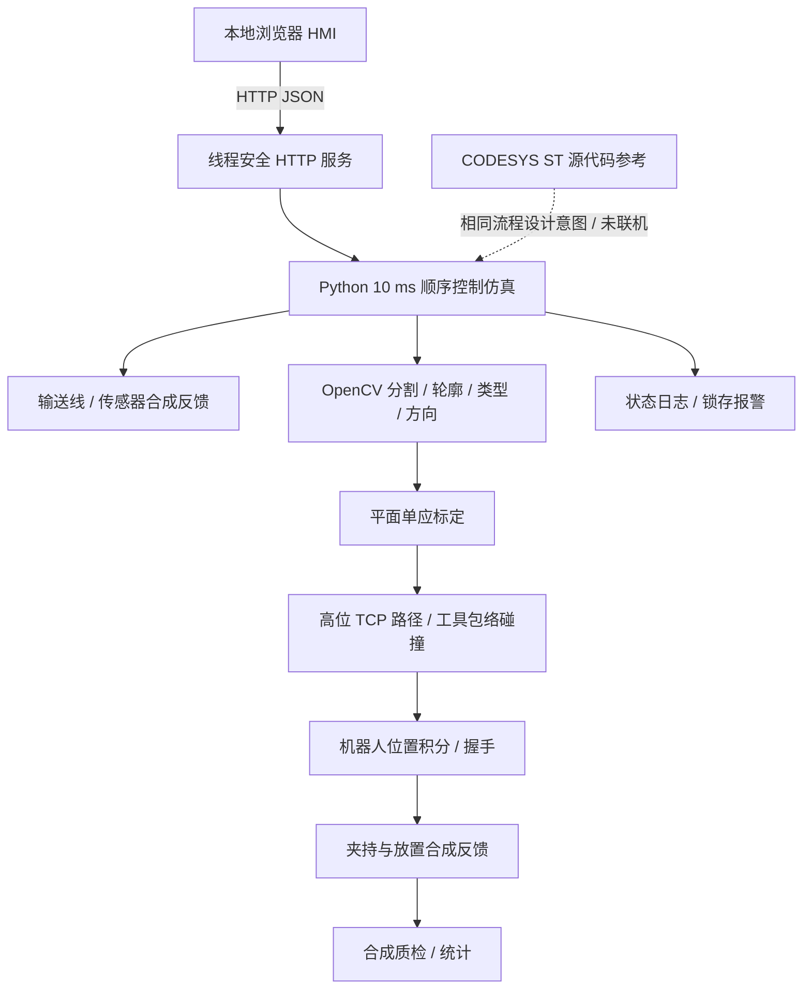

# 系统架构与接口

HMI 的每个 HTTP 请求在锁内读取/修改状态，周期线程在同一个锁内调用 `Cell.tick(0.01)`。没有实时调度保证；Windows 调度、图像运算和浏览器刷新可能导致墙钟时间比仿真时间慢。性能报告同时标明两种时间。

## HTTP

服务只绑定 127.0.0.1。本地接口是 HMI 到仿真的连接；不是已经实现的 PLC→机器人 TCP 或 OPC UA 驱动。

| 方法 | 路径 | 内容 |
|---|---|---|
| GET | / | HMI |
| GET | /api/status | 状态、I/O、统计、当前报警、最近 12 次状态转换 |
| GET | /api/frame | 合成 JPEG 图像与定位标记 |
| POST | /api/command | JSON 指令；拒绝跨 Origin 请求 |

示例：`{"command":"start"}`、`{"command":"fault","fault":"robot_timeout"}`、`{"command":"clear_fault"}`、`{"command":"reset","clear_part":true}`。联锁拒绝返回 HTTP 409，非法请求返回 400。

Robot 的 `Start` 置位后，`Running` 接受本次任务，控制器撤销 `Start`。结束时 `Complete` 锁存，控制器确认后 `Ready` 重新置位。未确认完成时禁止下一个任务。Python 中适配器是进程内 Robot；ST 中对应布尔 I/O 块。实体集成需要传输目标位置、事务 ID、超时/心跳与经过验证的安全运行权限。

## 坐标与运动

图像 u 向右，v 向下；基坐标 X 向右，Y 向上，单位 mm。合成相机真值为 `X=190+0.5u, Y=210-0.5v`。用四个角点估计 H，目标必须位于标定凸包内。方向通过目标点与其局部方向邻点一起投影得到，不能直接把图像角度送给机器人。圆/环的 yaw 为 0，方形以 90° 对称，环没有偏心孔方向信息。

所有工件在 Z=25 平面。`PrePick/PrePlace` 高度为 160。夹具顶面 Z=80，工具半径假设为 20。线段对膨胀 AABB 做连续相交检测，目标在夹具内直接拒绝。路径不是 MoveIt，检查对象只有 TCP 工具包络。没有臂杆、腕部、关节限位、姿态连续性、加速度或负载模型。yaw 在模拟中直接设定，不模拟旋转轴速度。

合成图使用单一亮色前景、暗背景、固定大小和高对比度。真实应用需要曝光/光照设计、内参去畸变、工件高度误差评估、遮挡和多工件策略。当前多目标会拒绝，未实现输送带动态跟踪。
