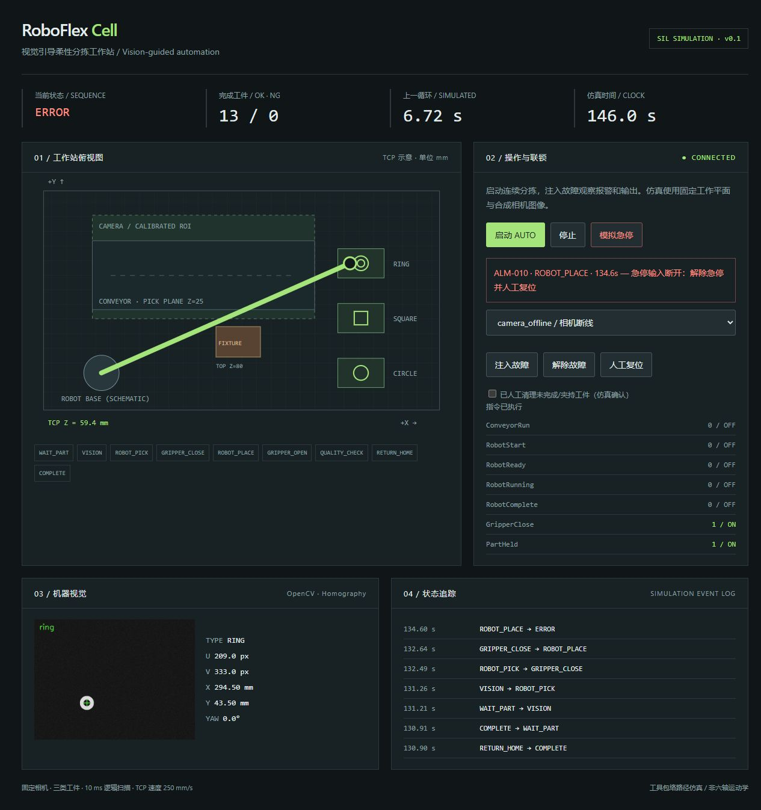

# 软件在环验证报告

日期：2026-10-06（Asia/Shanghai）。环境：Windows 10 build 19045、Python 3.12.14、OpenCV 4.12.0、NumPy 2.2.6、pytest 8.4.2。测试对象为本仓库的 Python/OpenCV SIL，不包含硬件、CODESYS 编译或 ROS2/MoveIt。

## 自动化与浏览器验证

运行 `python -m pytest -q`：**43 passed**。覆盖三类工件、坐标/方向变换、独立验证点、目标越界、路径拒绝、工具包络避让、机器人完成锁存、完整状态序列、12种故障与恢复、持件安全停止、操作员停止、HTTP接口和非法/跨源请求。

浏览器实操：启动连续分拣 → 完成多轮 → 持件放置过程中急停 → 显示 ALM-010 与出错工序 → Start 被拒绝 → 解除原因但未确认清理时 Reset 被拒绝 → 清理确认与复位 → 回到 IDLE 且未自动启动。截图是实际本地 HMI，不是设计稿。

浏览器验证中修复了一个实际问题：HTMLButtonElement 的 `command` 属性遮蔽同名全局函数，导致 onclick 报错。改为 `sendCommand` 后重新验证启动与停止流程。桌面及窄屏布局已检查，窄屏document宽度等于viewport宽度，无横向溢出。机械草图按生成源重建，4个SVG结构与3个DXF的ezdxf读取/audit通过；没有在 AutoCAD/SolidWorks 中做实体装配验证。Python wheel构建成功，包含HMI页面资源。

## 100 次正常循环

运行：`python -m roboflex.cli benchmark --cycles 100 --seed 42 --output docs/evidence/benchmark`。

| 指标 | 本次运行结果 | 解释 |
|---|---:|---|
| 正常完成 / 总循环 | 100 / 100 | 正常无注入故障的合成场景 |
| NG | 0 | 正常合成质量反馈；不代表真实产品良率 |
| 平均逻辑周期 | 6.3255 s | 10ms仿真时钟与250mm/s TCP模型 |
| P95逻辑周期 | 6.721 s | 同上，不是实体节拍 |
| 平均合成定位误差 | 0.001554 mm | 理想标定、亮色前景、固定高度 |
| 最大合成定位误差 | 0.049880 mm | 不包含镜头、标定点、机械误差 |
| 基准墙钟耗时 | 0.6491 s | 离线快速推进仿真；随电脑变化 |

原始证据：[`results.json`](evidence/benchmark/results.json)、[`cycles.csv`](evidence/benchmark/cycles.csv)。每条记录含工件真值、检测位置、类别、周期和路径长度。合成几何真值由图像生成器保存，误差对该真值计算；不同随机种子会生成不同工件。

100次循环中的正常完成率不能称为工业“抓取成功率”，因为抓手接触、掉落、摩擦和装配质量没有物理仿真。理想图像的定位误差很小，不是相机精度承诺。

## 带噪声的独立标定验证

运行：`python scripts/calibration_report.py`。

非仿射真值投影矩阵 → 20组标定，每组20个角点加入0.6px标准差噪声 → 每组50个未用于标定的验证点加入同等检测噪声。机器人参考坐标设为精确，未加入机器人测量误差或畸变。

| 1,000个独立验证点 | 误差 |
|---|---:|
| 均值 | 0.372775 mm |
| P95 | 0.748317 mm |
| 最大值 | 1.059321 mm |

证据：[`calibration.json`](evidence/calibration.json)。它展示“拟合残差不等于定位精度”：实际标定应保留独立验证点，还要评估镜头畸变、标定板尺寸、机器人示教精度、工作平面高度和视野边缘误差。

## 故障恢复

运行 `python scripts/fault_report.py`，12/12场景均触发预期报警、停止输送线/RobotStart/RobotRunning、有故障原因时拒绝复位、解除原因并人工清理后回到IDLE、再次启动完成1个正常循环。

证据：[`faults.json`](evidence/faults.json)，含报警时刻、出错工序、输出检查和恢复结果。机器人超时通过冻结运动模型制造，规划失败通过将目标移入夹具制造，通信丢失通过停止合成心跳更新制造。

## 可复现性与待验证项

种子固定时合成图、周期记录和几何误差可重现。墙钟时间、HTTP状态快照和截图中的模拟时刻会变化。GitHub Actions定义了Windows/Linux、Python3.10/3.12矩阵；本报告只陈述本地已完成结果，CI状态需查看仓库实际运行记录。

未验证：CODESYS ST编译与扫描执行；真实PLC I/O；完整六轴可达性/碰撞/动力学；KUKA控制器；实物夹持/质量/安全；CAD制造公差与机械刚度。本版本没有实际装配工序。需要这些验证后才能形成实体设备验收报告。
